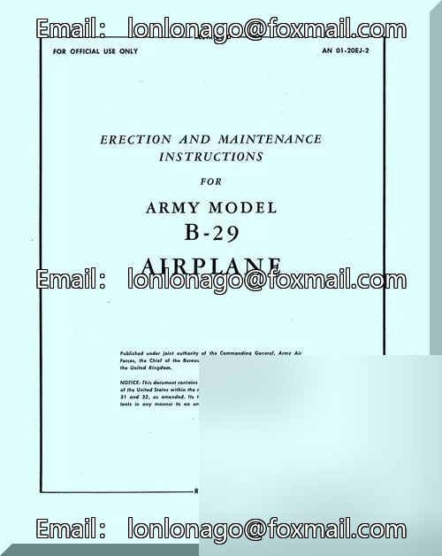

# B-29 military maintains the original manual

## Body

B-29 military maintenance manual for the U.S. military original B-29 bomber (Model B-29), version of November 10, 1944, and revised on February 20, 1945.
948 pages
I. Content
1. Official formal documents, covering the entire process of the aircraft structure, installation, maintenance, weapon systems, etc.
2. Rich details, with extensive exploded views, part numbers, and operation process explanations.
3. Suitable for research in aerospace technology, model-making, and reference for history enthusiasts.
II. Document features
Authority: The U.S. military original version, authoritative and reliable content
Practicality: Detailed exploded views, installation, and maintenance processes, with clear figures and diagrams
III. Delivery method
free of return upon sale

This document is the B-29 military maintenance original manual, covering aircraft structure, installation, maintenance and weapon systems across the full process, with breakdown diagrams, part numbers and operation instructions.

<!-- AI_ENRICHED -->

## Images

## Payment

Here is a pay link on Stripe ( https://buy.stripe.com/3cs8yP7sY87d0vu9AB ). Please contact me lonlonago@foxmail.com after funding $89, and I will send you a complete data files , thank you!

